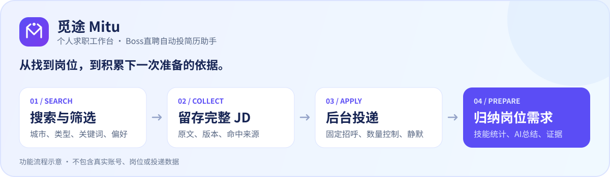

<p align="center">
  
</p>

<h1 align="center">Boss自动投简历助手</h1>

<p align="center">
  <strong>觅途 Mitu · 求职神器 · Boss直聘自动投简历 · 无感化自动投递</strong>
</p>

<p align="center">
  搜索合适岗位，后台处理投递，把 JD 留作下一次准备的依据。
</p>

<p align="center">
  <a href="front/package.json"></a>
  <a href="#开始使用"></a>
  <a href="front/package.json"></a>
  <a href="LICENSE"></a>
  <a href="https://github.com/CloudskyRan/boss-auto-apply-assistant/stargazers"></a>
</p>

<p align="center">
  <a href="#核心功能">核心功能</a> ·
  <a href="#开始使用">开始使用</a> ·
  <a href="#常见问题">常见问题</a> ·
  <a href="#后续计划">后续计划</a> ·
  <a href="docs/usage.md">使用指南</a> ·
  <a href="https://github.com/CloudskyRan/boss-auto-apply-assistant/issues">反馈问题</a>
</p>

---

**觅途 Mitu** 是面向 **Boss直聘（BOSS直聘 / BOSS Zhipin）** 的个人求职工作台。它把岗位搜索筛选、自动投递简历、固定招呼语、JD 留存与 AI 需求总结放在同一个界面，帮助实习、应届生和社招求职者减少重复操作，积累有依据的求职准备资料。

“无感化自动投递”指浏览器最小化后在后台处理常规操作。登录失效或出现人工验证时，仍需接管浏览器。

> [!IMPORTANT]
> 当前为 **Windows 本地单用户源码版**。首次安装仍需准备带正确表结构的 `db/getjobs.db` 和前端依赖，完整空库初始化及干净环境安装流程尚未补齐。已有环境可继续使用；新用户先阅读[构建前提](docs/usage.md#源码构建与运行)。定时投递、账号注册及多人在线服务仍在规划中。

## 核心功能

### 搜得更明确

- **全国或指定城市**：按多个关键词依次搜索，职位类型单选，支持“不限”、全职、实习和兼职。
- **按条件筛选岗位**：薪资、经验、学历、公司条件、HR 活跃度与黑名单集中管理。

### 投得有节奏

- **独立数量上限**：分别限制本次检查多少岗位、尝试发起多少次沟通，跨关键词和城市累计。
- **固定或 AI 招呼语**：填写自己的固定信息，或按岗位生成内容；保留固定信息作为 AI 失败的备用文本。
- **静默投递**：复用详情/聊天页，后台最小化运行；工作台随时查看进度、停止或接管浏览器。
- **记录与统计**：保留岗位记录和沟通结果，支持筛选、详情查看与导出；单个岗位异常不直接结束整批处理。

### 把岗位要求留下来

- **完整 JD 留存**：通过筛选后、发起沟通前保存，保留原文、版本和搜索来源。
- **累计需求总结**：本地统计技能提及，按范围生成带原文证据、覆盖率和来源清单的 AI 报告，为简历准备提供依据。

另有独立的**笔试练习助手**，支持题目输入、Windows 本机 OCR 与显式 AI 解析。完整操作见[使用指南](docs/usage.md)。

## 工作流程



*功能流程示意，非真实界面截图；不包含真实账号或投递数据。*

符合条件的岗位即使没有沟通成功，也可以进入 JD 岗位库。投递结果和 JD 留存分别记录；需求总结帮助准备简历，当前不会自动改写简历。

## 开始使用

### 已有本地环境

1. 启动服务，打开 **[投递工作台](http://localhost:6866/boss/)**，在项目浏览器中完成 Boss 登录。
2. 填写关键词、城市和职位类型，在“沟通内容 → 编辑”中填写固定招呼语。
3. 设置本次搜索和投递上限，确认静默模式已保存，再点击“开始投递”。
4. 从工作台查看进度；从“岗位统计”和“JD 岗位库”查看记录及岗位要求。

开始操作会先保存当前表单，运行期间配置不可修改。需要登录或验证时，点击“查看浏览器”处理，再点击“继续后台”。

### 从源码构建

**环境**：Java 21、Node.js 22 或兼容版本、npm、Google Chrome。完整桌面/OCR能力以 Windows 环境为主。

```powershell
git clone https://github.com/CloudskyRan/boss-auto-apply-assistant.git
cd boss-auto-apply-assistant
```

先准备有效数据库和前端依赖，再从项目根目录运行：

```powershell
.\gradlew.bat bootRun
```

`bootRun` 会调用前端构建和 Patchright driver 安装，并设置浏览器运行路径。首次构建需要下载依赖；当前不把克隆到首次启动描述为已经验收的一键安装流程。

<details>
<summary><strong>需要打包成 JAR？</strong></summary>

在有效数据库和前端依赖已准备好的前提下：

```powershell
.\gradlew.bat installPatchrightDriver bootJar

$env:PLAYWRIGHT_NODEJS_PATH = (Get-Command node.exe).Source
$mituDriver = (Resolve-Path .\build\patchright-driver).Path
java "-Dplaywright.cli.dir=$mituDriver" -jar .\build\libs\mitu-3.1.0.jar
```

`bootJar` 自身不安装 Patchright driver，运行也不只依赖一个 JAR。前端手动构建、依赖安装限制、数据保留和升级说明见[构建与运行指南](docs/usage.md#源码构建与运行)。

</details>

管理页面端口为 `6866`，后端 API 端口为 `9527`。启动服务不会自动投递。

## 常见问题

<details>
<summary><strong>搜索上限和投递上限有什么区别？</strong></summary>

搜索上限统计开始检查的候选岗位，包含过滤、跳过和详情失败；投递上限统计尝试发起沟通，发起后发送失败也计入。达到任意一项上限即结束，`0` 表示该项不限。

例如搜索上限为 `100`、投递上限为 `20`，最多检查100个候选、尝试发起20次沟通，实际可能更少。这两项只控制本次任务，不计算当天剩余名额。

</details>

<details>
<summary><strong>为什么长固定招呼语前面会出现平台默认问候？</strong></summary>

平台首条招呼有长度限制。兼容流程可能先触发默认问候，再进入聊天页发送完整信息；默认问候出现不代表固定文本已发送成功。请同时检查 Boss 账号自身的自动招呼设置，并按实际记录核对结果。详见[固定招呼语](docs/usage.md#固定招呼语)。

</details>

<details>
<summary><strong>无感化自动投递是不是完全没有浏览器窗口？</strong></summary>

静默模式保留有界面的 Chrome，通过最小化和复用页面减少干扰。查看和后台控制在当前操作结束后的检查点执行；登录、验证码及其他人工验证仍需用户处理，不承诺所有平台弹页都零闪现。

</details>

<details>
<summary><strong>JD 总结会自动调用 AI 吗？能直接修改简历吗？</strong></summary>

本地统计不需要模型。自动 AI 分析默认关闭，启用或手动分析后，所选 JD 文本会发给系统设置中配置的 AI 服务。报告保留范围、覆盖率和原文依据。

当前提供岗位需求总结和简历准备建议，简历导入、匹配及自动改写尚未实现。

</details>

<details>
<summary><strong>首次启动提示缺表，或前端依赖安装失败，怎么办？</strong></summary>

不要用空文件代替 `db/getjobs.db`。当前尚无完整首次初始化流程，缺少必要表会导致启动失败。前端的包管理器版本及部分构建脚本授权配置也仍需整理，不能保证全新环境安装已经通过。具体限制见[构建前提](docs/usage.md#源码构建与运行)。

升级已有环境应保留 `db/` 与 `browser-data/`，不要上传或分享个人数据库。

</details>

<details>
<summary><strong>能直接放到公网，供多人注册使用吗？</strong></summary>

当前按本机单用户设计，账号注册、统一鉴权、数据隔离与设备派发尚未实现，不直接公开工作台端口。后续路线见[定时投递与多人服务方案](docs/automation-multiuser-roadmap.md)。

</details>

## 后续计划

- [ ] 补齐首次空库初始化和全新环境依赖安装流程。
- [ ] 整理可复现构建、受控回归测试及发布流程。
- [ ] 本地定时投递：持久计划、每日预算、任务互斥与防重复执行。
- [ ] 简历导入、JD 匹配分析与针对性修改。
- [ ] 注册登录、多用户隔离和执行端配对。

以上均为规划项，不代表已经上线。详细边界见[实施路线](docs/automation-multiuser-roadmap.md)。

## 文档与反馈

- [使用指南](docs/usage.md)：构建、配置、招呼语、静默模式、JD、统计及桌面练习。
- [JD 留存与总结](docs/jd-collection-plan.md)：采集、版本、分析和证据。
- [静默运行说明](docs/quiet-delivery-plan.md)：实现、验证与兼容边界。
- [项目架构](docs/architecture.md)：模块、数据和开发约定。
- [源码发布说明](docs/source-publication.md)：当前版本范围与部署限制。
- [提交问题](https://github.com/CloudskyRan/boss-auto-apply-assistant/issues/new)：说明系统环境、复现步骤、预期和实际结果，并附脱敏日志。

欢迎提交问题和 PR，尤其是首次安装、构建复现、平台页面兼容及测试方面的改进。提交前请阅读 [PR 模板](.github/PULL_REQUEST_TEMPLATE.md)，不要包含 Cookie、数据库、简历、密钥或其他私人资料。

## 使用许可

本项目面向非商业求职场景公开源码，适用 **PolyForm Noncommercial License 1.0.0**，包含非商业用途限制。完整条款见 [LICENSE](LICENSE)，必要版权声明见 [NOTICE](NOTICE)。
